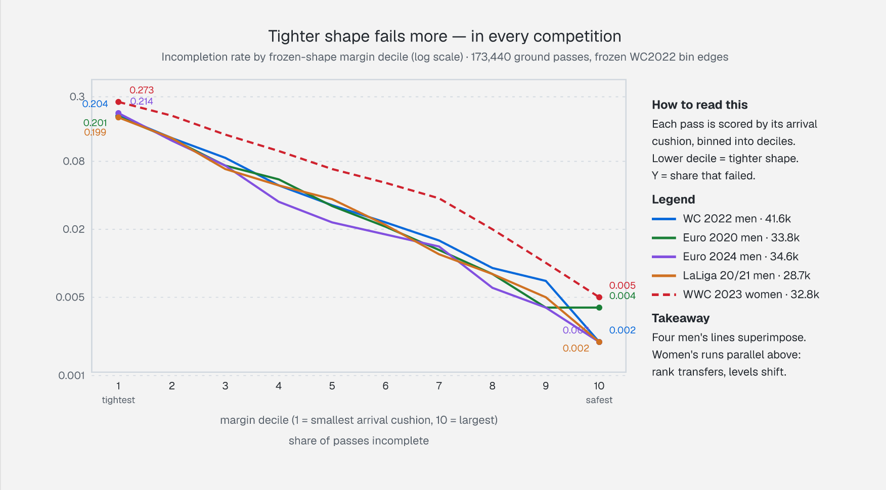
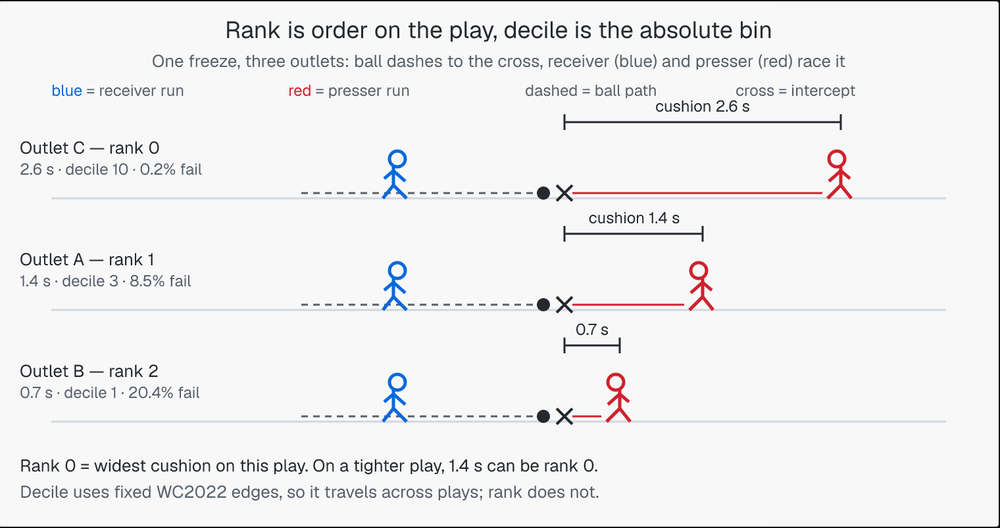

# Football Outlet Rank

Safety of a receiving outlet as a physical race, not a distance heuristic.
Both sides race to the ball-to-runner intercept.

**Who this is for:** football analysts and researchers who rank passing
options under pressure. Any player in possession can be the passer, not
just the goalkeeper. If you score outlets, pick passes, or study
progression against a press, this is a tested unit for "does the ball arrive
before the defender" — calibrated on 173,440 open-data passes across five
tournaments, men's and women's.

## What it says

Score every outlet by its arrival cushion, rank them safest-first. The
bottom decile fails at 20–27%; the top at 0.2–0.5% — monotone across all
five datasets. Rank 0 fails at 0.02–0.05; failure rises every rank.
Passers pick the safest outlet ~43% of the time.



**Reading the chart:** decile 1 = tightest frozen-shape cushion, decile 10 = safest. Absolute seconds are inflated (frozen shape, standing starts) — trust the ordering, not the clock. Women's curve runs parallel above men's: same ranking power, higher levels, so scale levels per pace environment (`pace_k`), not edges.

Example: a 0.8 s margin sits in decile 1 (edge 1.01 s). Historically ~20% of men's and ~27% of women's passes there went incomplete. The 0.8 s is `t_press - t_ball` to the intercept, not presser distance to the receiver; incomplete means any failure, not a turnover to that presser.

### Rank 0 vs decile 10

Two scales. Play rank is relative to one freeze; decile is absolute against fixed WC2022 edges.

- Play rank (`rank_outlets`): sort the outlets on one freeze by margin (`t_press - t_ball`) largest-first. Rank 0 is the best outlet on that play, the largest margin available. `rank_outlets([2.6, 1.4, 0.7])` gives rank 0 to 2.6 s, rank 1 to 1.4 s, rank 2 to 0.7 s. Fitted failure: rank 0 ~2.4%, rank 1 ~4.3%, rank 2 ~7.5%, rising to ~21% by rank 6.
- Margin decile (`margin_decile`): bin one margin against fixed edges (1.01, 1.31, 1.52, 1.70, 1.85, 1.99, 2.13, 2.29, 2.50 s). Decile 1 = margin below 1.01 s; decile 10 = margin above 2.50 s. Fitted failure: decile 1 ~20.4% down to decile 10 ~0.2%, monotone.

Rank answers which outlet is safest here. Decile answers how safe that margin is anywhere. A 1.4 s outlet is rank 0 on a tight play and rank 1 on the play below; its decile is 3 either way.



Same bin, higher level elsewhere: a decile-1 margin fails ~20% in men's ball, ~27% in women's (`pace_k` ≈ 1.5) — the bin travels, the level doesn't.

## Quick Start

```bash
python3.11 -m venv .venv
source .venv/bin/activate
pip install -r requirements.txt
pytest -q
```

## Usage

```python
from src.core.geometry import PitchPoint
from src.models.pressing.arrival import arrival_margin
from src.models.pressing.readiness import receiver_readiness
from src.models.pressing.types import PressingActor
from src.models.pressing.calibration import rank_outlets, rank_risk

receiver = PressingActor(track_id=9, team_id="own", pos_m=PitchPoint(86.0, 25.0))
presser = PressingActor(
    track_id=1, team_id="opp",
    pos_m=PitchPoint(87.5, 26.5), vel_ms=(-4.0, -2.0),
)
res = arrival_margin(receiver, [presser], PitchPoint(100.0, 29.0))
ready = receiver_readiness(receiver, PitchPoint(100.0, 29.0))
print(res.margin_s, res.t_ball_s, res.t_press_s, res.best_presser_id)
print(ready.reception_latency_s, ready.post_cushion_s(res.margin_s))
print(ready.retention_prob(res.margin_s))

# Rank outlets on raw arrival margin; retention is diagnostic only, never ranked on:
outlets = [1.9, 0.4, 1.2]  # margins per outlet
ranks = rank_outlets(outlets)
print([(r.rank, rank_risk(r.rank)) for r in ranks])
```

- `src/models/pressing/arrival.py` — `flight_time_s`, `intercept_target`,
  `presser_engagement_latency_s`, `presser_arrival_s`, `arrival_margin`.
- `src/models/pressing/calibration.py` — `rank_outlets`, `margin_decile`,
  `decile_risk`, `rank_risk` (WC2022 fit; `pace_k` re-scales levels per
  pace environment), `outlet_value` (safety-times-upside, descriptive).
- `src/models/pressing/readiness.py` — `resolve_facing`,
  `receiver_readiness`, retention probability on `ReadinessResult`.
- `src/models/pressing/types.py` — `PressingActor`, `gate_tracking_velocity`.
- `src/io/metrica.py` — Metrica sample-data loader: tracking frames to
  `PressingActor`s with measured per-pass ball speed (wakes `pass_speed_ms`
  and `live_pressers`; facing stays unknown).
- `src/io/skillcorner.py` — SkillCorner Open Data loader: 10 fps broadcast
  tracking with roster sides, measured ball peaks, real pass outcomes.
- `src/physics/arrival_constants.py` — 8 arrival-race constants, single source.
- `src/physics/biomechanics.py` — hip-pivot latency + angle wrap.
- `src/core/geometry.py` — `PitchPoint`, pitch dimensions.
- `arrival.md` — research note: values, novelty, deleted priors.
- `docs/figs/fig1_decile_curves.png`, `docs/figs/fig2_rank_example.png` — figures.

- `data/wc2022`, `data/euro2020`, `data/laliga`, `data/euro2024`,
  `data/wwc2023` — open 360 freeze-frames (untracked, local only).

## Sources

Physics concepts are borrowed, values are assumed (see
`src/physics/arrival_constants.py` for per-constant notes):
Spearman et al. 2017 (Hudl SSAC, physics-based pass probabilities —
time-to-control concept); Morin et al. 2016 + Samozino et al. 2021 (sprint
force-velocity profiling method); FIFA Quality Programme for Football Turf
(ball-surface interaction is regulated); Lees & Nolan 1998 (kicking
biomechanics, hip-pivot latencies). Pass data: StatsBomb Open Data 360
freeze-frames (WC 2022, Euro 2020/2024, LaLiga 20/21, WWC 2023);
SkillCorner Open Data (MIT, 10+ broadcast-tracked A-League matches,
dynamic events with real pass outcomes).
