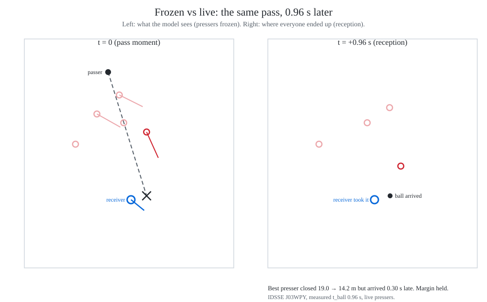
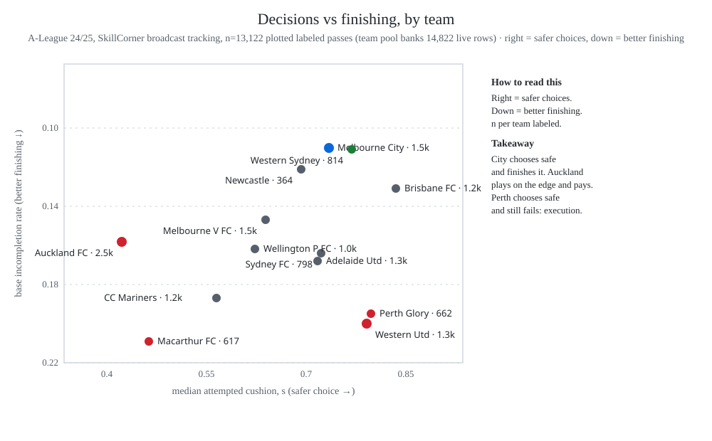

# Football Outlet Rank

Safety of a receiving outlet as a physical race, not a distance heuristic.
Both sides race to the ball-to-runner intercept.



Anyone can read this; analysts and researchers will get the most from
it. Any player in possession can be the passer, not just the goalkeeper.

## What it says

**Rank orders risk.** Bottom decile fails at 20–27%; the top at
0.2–0.5% — monotone across all six datasets. Rank 0 fails at 0.02–0.05;
failure rises every rank. Passers pick the safest outlet ~43% of the time.


Absolute seconds are inflated (frozen shape, standing starts) — trust
the ordering, not the clock. Decile 1 = tightest cushion, decile 10 =
safest; play rank (`rank_outlets`) sorts outlets on one freeze
safest-first, decile bins one margin against fixed WC2022 edges.

**Levels shift with pace, order doesn't.** The women's curve runs
parallel above men's: same ranking power, higher levels — so scale
levels per pace environment (`pace_k` ≈ 1.5), not edges.

**Decisions separate teams; finishing decides tables.** Base
incompletion spreads 2x across 13 A-League clubs, median attempted
cushion spreads 2x — Melbourne City leads both. But rank predicts
arrival, not points (corr ≈ −0.25):



Full story: [`docs/table-vs-fingerprints.md`](docs/table-vs-fingerprints.md).

## How to use it

Three moves, full version in [`docs/methods.md`](docs/methods.md):

1. **Rank** every outlet by arrival cushion (`rank_outlets`).
2. **Re-scale** levels per pace environment (`decile_risk(decile, pace_k)`).
3. **Measure** seconds where tracking exists (`measured=(intercept, t_ball)`).

## Quick Start

```bash
python3.11 -m venv .venv
source .venv/bin/activate
pip install -r requirements.txt
pytest -q
```

## Usage

```python
from src.core.geometry import PitchPoint
from src.models.pressing.arrival import arrival_margin
from src.models.pressing.readiness import receiver_readiness
from src.models.pressing.types import PressingActor
from src.models.pressing.calibration import rank_outlets, rank_risk

receiver = PressingActor(track_id=9, team_id="own", pos_m=PitchPoint(86.0, 25.0))
presser = PressingActor(
    track_id=1, team_id="opp",
    pos_m=PitchPoint(87.5, 26.5), vel_ms=(-4.0, -2.0),
)
res = arrival_margin(receiver, [presser], PitchPoint(100.0, 29.0))
ready = receiver_readiness(receiver, PitchPoint(100.0, 29.0))
print(res.margin_s, res.t_ball_s, res.t_press_s, res.best_presser_id)
print(ready.reception_latency_s, ready.post_cushion_s(res.margin_s))
print(ready.retention_prob(res.margin_s))

# Rank outlets on raw arrival margin; retention is diagnostic only, never ranked on:
outlets = [1.9, 0.4, 1.2]  # margins per outlet
ranks = rank_outlets(outlets)
print([(r.rank, rank_risk(r.rank)) for r in ranks])
```

Modules: `models/pressing/` (arrival, calibration, readiness, types),
`physics/` (constants, biomechanics), `core/geometry.py`,
`io/` (metrica, skillcorner, idsse loaders). Research note:
`arrival.md`. Pooled evidence: `data/pooled/`
(SkillCorner n=14,814, IDSSE n=673). Reproduce every table:
`python3 scripts/reproduce.py` (numpy + stdlib only, seconds).

## Data & licence

StatsBomb Open Data: github.com/statsbomb/open-data (360
freeze-frames). Metrica sample: github.com/metrica-sports/sample-data.
SkillCorner Open Data: github.com/SkillCorner/opendata (MIT). IDSSE:
Hugging Face `pysport/idsse-data` (CC-BY 4.0, Bassek et al. 2025).
Code is MIT — see LICENSE.

## Sources

Each dataset exists because the previous one hit a wall: StatsBomb 360
(173,440 passes, frozen gradient) → Metrica (25 Hz velocities, no
outcomes) → SkillCorner (20 matches, real outcomes, broadcast 10 fps)
→ IDSSE (Bassek et al. 2025, TRACAB 25 fps, measured receptions).
The chain converges on one instrument: rank from frozen shape, levels
per pace, seconds from measurement.

Physics concepts borrowed, values assumed (per-constant notes in
`src/physics/arrival_constants.py`): Spearman et al. 2017
(time-to-control); Morin et al. 2016 + Samozino et al. 2021 (sprint
profiling); FIFA Quality Programme (ball-surface interaction);
Lees & Nolan 1998 (hip-pivot latencies).
